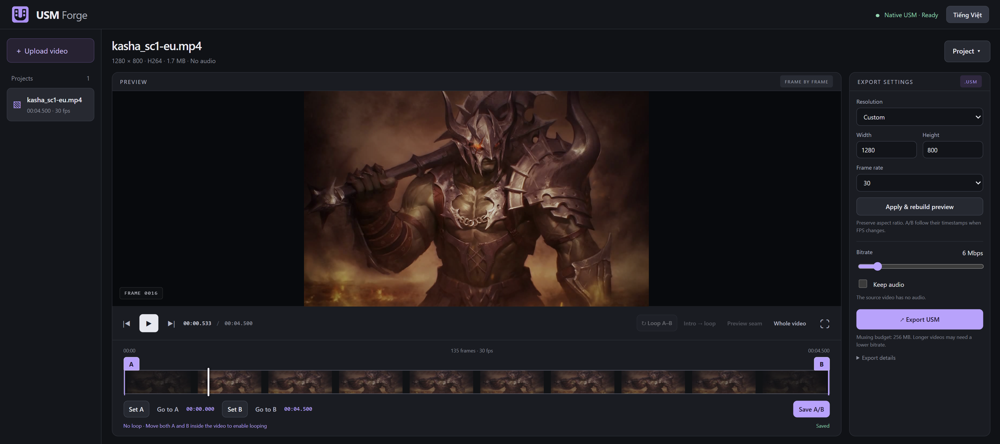

# USM Forge

**Convert videos to USM. Set A/B cue points. Preview loops.**

A local web app for converting common video formats to CRI USM, with frame-by-frame inspection, cue-point editing, and loop preview before export. The Linux container runs the whole pipeline using FFmpeg and CriCodecs. No Wine or proprietary Windows encoder is required.

The interface supports **English and Vietnamese**. Use the language button in the top-right corner to switch; your choice is remembered in this browser. This is an independent community project, not an official CRIWARE or Lineage II tool.



*The editor with a user-provided video. Game imagery shown in this screenshot belongs to its respective rights holders; the source video is not bundled.*

## Features

- Upload MP4, WebM, MOV, MKV, AVI, readable USM files and other formats supported by the installed FFmpeg build. Upload and processing progress appear in the sidebar.
- Play the normalized preview or inspect individual frames, with a loading indicator while the selected frame is being retrieved.
- Edit exactly two cue points, A and B, using draggable timeline markers, keyboard nudges, or **Set A / Set B**; jump to them with **Go to A / Go to B**.
- Import/export A/B cue text and project JSON from the **Project** menu.
- Preview A–B loops, intro-then-loop playback, and a rendered clip across the loop boundary.
- Export MPEG-1 video with optional stereo ADX audio in a USM container, with cue points embedded.
- Download USM, cue text, project JSON, and a structural/decoder verification report from the native encoder.
- Compact desktop layout with English/Vietnamese switching; smaller screens can scroll to keep all controls accessible.

## Quick start

Install Docker with Compose, or Podman with a working Compose provider. On Windows/macOS, initialize and start the container virtual machine first if needed. Use an x86-64 machine for the tested configuration.

From the project folder:

```sh
podman compose up -d --build
```

Or:

```sh
docker compose up -d --build
```

Open **http://localhost:3213**. The first build needs internet access. FFmpeg, Python and the muxer are installed inside the image; there is no encoder directory to download or mount separately.

The named volume `usm-data` stores uploads, projects and exports. `compose down` keeps it; `compose down -v` deletes it. Back up the volume separately from the source repository.

If port 3213 is occupied, set `USM_PORT` before starting. For example, in PowerShell:

```powershell
$env:USM_PORT = '3214'
podman compose up -d --build
```

Without Compose:

```sh
podman build --format docker -t localhost/usm-forge:0.2.0 .
podman run -d --name usm-forge -p 127.0.0.1:3213:3210 -v usm-forge-data:/data --init localhost/usm-forge:0.2.0
```

This repository supplies source and local build instructions. It does not advertise a prebuilt public image. See [image distribution requirements](docs/IMAGE_DISTRIBUTION.md) before publishing one yourself.

## Using the editor

1. Upload a video and follow upload/normalization progress in the sidebar. Preview, frame inspection, cue positions and export all use the same constant-frame-rate master.
2. Use Space for play/pause and the left/right arrows to inspect frames. Frame numbering starts at zero.
3. Every project has exactly two cues: A (ID 1), initially at frame 0, and B (ID 2), initially at `totalFrames`. Drag their timeline handles, or focus a marker and use left/right arrows (Shift for 10 frames; Home/End for the allowed limits). **Set A / Set B** use the current frame; **Go to A / Go to B** jump to a boundary. B can be one past the last frame; going to B at the video end displays the last actual frame. Click **Save A/B** before switching projects. There is no separate cue table or numeric frame-entry field.
4. Looping is enabled only when both A is after frame 0 and B is before `totalFrames`. Playback includes A and stops before B: `[A, B)`. The transport groups play/pause, A–B loop, intro-then-loop, seam preview, and whole-video playback. Whole-video playback runs once.
5. Use **Preview seam / Xem đoạn nối** to render the last part before B followed by the first part starting at A. This avoids browser seek latency when judging the visual join; this short clip is silent.
6. If you change resolution or FPS, apply the settings. A/B are preserved by time and remapped to the nearest frame; the end boundary remains at the new video end.
7. Choose bitrate and whether to keep audio, then export. **Export is ready** expands to show the latest result's downloads. Each export stores a snapshot of settings and cues. Exporting processes the full video, not just the A/B interval.

The **Project / Dự án** menu contains project JSON save/restore, A/B text import/download, and project deletion. It closes when you select an action, click outside, or press Escape. Deleting a project removes its uploaded copy, previews and exports, not the original file on your computer.

The loop controls simulate the interval you select. They do not infer game behavior from names such as `loop_point`. Actual cue handling is up to the game client.

## Cue and project files

The first line of `cue_point.txt` is the timebase in ticks per second. Each subsequent line contains `time,id,name`:

```text
1000
500,1,A
6500,2,B
```

Text imports must contain exactly two cues and are snapped to the nearest frame, then normalized to A (ID 1) and B (ID 2). Exports use 1000 ticks/second and rounded millisecond timestamps. Additional cue parameter columns are not supported. Existing project JSON files retain their saved A/B range when migrated to two cues; old exported files are not modified. `loop.enabled` is derived from both boundaries being inside the video, not an independent setting or a guarantee of game-client behavior.

Project JSON contains settings/cues/loop selection, not the source video. To restore on another machine, upload the same video, apply the matching resolution/FPS, then import the JSON. The `usm-studio/v1` schema identifier is intentionally retained for compatibility with earlier project files.

## Output and limits

The native pipeline is source → FFV1 master → MPEG-1 video / optional ADX audio → USM. It uses no AVI intermediate. The app embeds cue metadata and adjusts seek offsets, then checks media hashes, decoded frame count, dimensions, and audio format. `verification.json` explicitly records `gameClientTested: false`.

- Upload limit: 512 MiB by default (`MAX_UPLOAD_MB`); maximum source duration: 600 seconds; source dimensions up to 8192 × 8192.
- Mux budget: 256 MiB by default (`MAX_ENCODE_MB`). Estimates include 25% headroom; actual elementary stream sizes are checked too. This is not a container RAM limit. The muxer can use several times the stream size in memory.
- Master files can consume many GB. Rebuilding retains earlier master/preview builds until the project is deleted. Temporary native export streams are removed after processing; projects and completed exports remain until deleted.
- Output: 24/25/30/50/60 fps; even width from 64 to 4094, even height from 64 to 2160; video bitrate from 1 to 40 Mbps. Aspect ratio is preserved with padding. Optional ADX audio is stereo at 48 kHz.
- No alpha preservation or HDR-specific processing. Browser looping may have seek latency.
- One serial processing/export queue and a separate serial frame-extraction queue. Interrupted jobs are marked failed after restart rather than automatically resumed.
- Linux amd64 is tested. ARM64 and direct playback/cue behavior inside a game client have not been validated.
- Designed for a trusted local user; no authentication or multi-user isolation. See [SECURITY.md](SECURITY.md).

## Development and tests

Node.js 22+ is required for development. Runtime video operations also need FFmpeg/FFprobe with USM demuxing. The Linux native backend needs Python 3.13 with the pinned dependencies in `requirements-native.txt`; using the supplied container is the easiest way to match them.

```sh
npm ci
npm test
```

`npm test` covers model/metadata logic, DOM interactions, and packaged logo/favicon assets; it does not run native encoding or a real browser.

For media/API checks, start a separate test instance using the container instructions above. On the machine running the smoke scripts, put FFmpeg and FFprobe on PATH (or set `FFMPEG_PATH` and `FFPROBE_PATH`), then generate synthetic fixtures:

```sh
npm run fixtures
node scripts/smoke.mjs
```

Smoke scripts default to `http://127.0.0.1:3213`; set `BASE_URL` to test another port. The basic script accepts `SMOKE_VIDEO` for another 8-second, 30-fps test input and intentionally retains its project for inspection. These tests create projects/exports on the server; do not point them at an instance holding important work.

**Known test limitation:** `scripts/smoke-audio.mjs` and `scripts/smoke-avi.mjs` still assert the legacy embedded cue names `loop_point` / `loop_start`. The current API normalizes those names to A/B, so these scripts need their expected names updated before they can pass against this version. They only clean up their server projects on success.

For a directly configured development environment, `npm start` defaults to `http://127.0.0.1:3210` (not Compose's host port 3213) and stores projects in `data/`. Set `HOST`, `PORT`, and `DATA_DIR` as needed; native encoding also needs the Python dependencies and `USM_BACKEND=native` / `PYTHON_PATH` configured appropriately. Merely running `npm ci` does not install media encoders.

`scripts/native-matrix.mjs` checks native encoding at all five supported frame rates in a configured Linux environment. Generated files stay in ignored `test-output/`; no sample game footage is needed.

An optional legacy Windows adapter remains in the source: set `USM_BACKEND=medianoche` and `ENCODER_PATH` to your own legally obtained encoder, plus FFmpeg/FFprobe as needed. No proprietary executable or SDK is supplied. The default Linux backend is native; this optional adapter is not required for the container.

## License and attribution

Original USM Forge code and documentation are under [MIT](LICENSE). Third-party components retain their respective terms; read [THIRD_PARTY_NOTICES.md](THIRD_PARTY_NOTICES.md).

CriCodecs has a public maintainer permission statement recorded in `docs/legal/`; it is not labeled MIT or Apache by this project. The Debian FFmpeg build uses GPL components. No source game videos, private project uploads, proprietary encoders, or downloaded upstream implementation source are included in this repository. The documentation screenshot contains user-provided game imagery for UI illustration; that third-party imagery is not covered by this project's MIT license.

Contributions: [CONTRIBUTING.md](CONTRIBUTING.md). Validation scope: [docs/VALIDATION.md](docs/VALIDATION.md).
